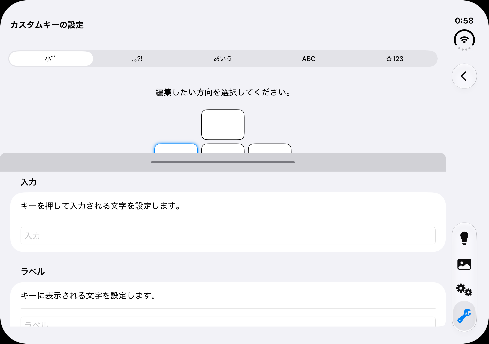
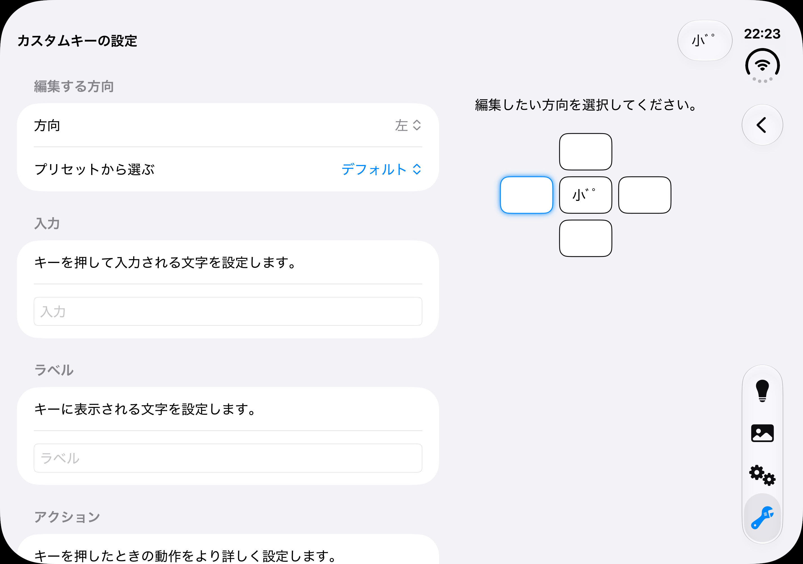
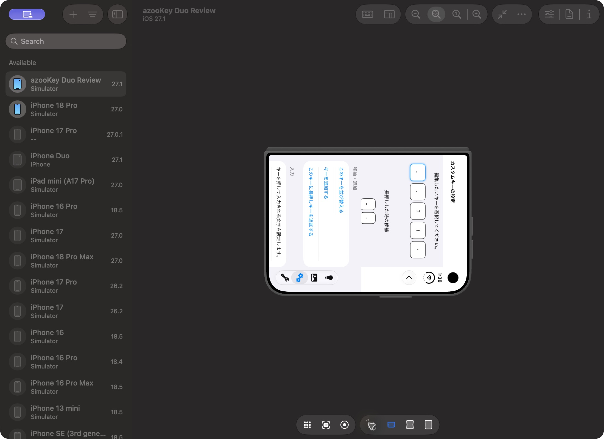
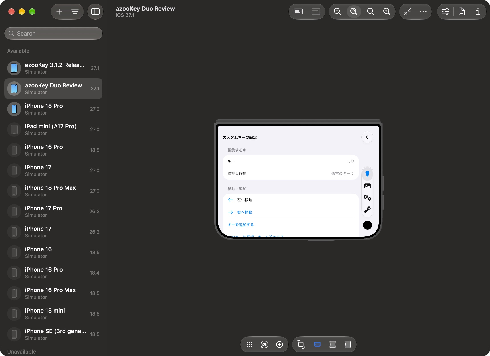

# iPhone Duo：変更前後の画面比較

この比較はPR #779の「画面レイアウト調整」のみを対象とします。左右フリックの追加は含みません。

| 条件 | 内容 |
| --- | --- |
| 変更前 | 上流mainの`a027203ef88162aa1b8f37a626a0089f719c60bb` |
| 変更後 | #779から左右フリックを分離したレイアウト調整版 |
| 共通の環境 | Xcode 27.1（27A9275）、Debug構成、iPhone Duo Simulator、iOS 27.1（24A94425）、日本語・ライト表示 |

画像は未加工です。見開きは内側画面（2853×2007px）、閉じた横画面は端末の向きが分かるDevice Hubウィンドウ（2200×1600px）を撮影しています。App Store配信バイナリの画像ではありません。キャプチャ条件とハッシュは[記録](images/iphone-duo/capture-manifest.json)に残しています。

## 見開き：フリックのカスタムキー編集

両方とも「小ﾞﾟ」の左方向を選択し、ソフトウェアキーボードを閉じた状態です。変更前は下から出る編集欄がキーのプレビューを覆います。変更後はフォームとプレビューを横へ並べ、方向選択・入力・ラベル欄とプレビューを同時に確認できます。フォームの続きはスクロールできます。

| 変更前 | 変更後 |
| --- | --- |
|  |  |

## 閉じた横画面：QWERTYのカスタムキー編集

両方とも閉じた端末を横向きに持ち、「。」キーを選択した画面です。変更前は縦表示のまま横倒しです。変更後は画面が横向きに追従し、幅・サイズクラスに応じたフォームを表示します。プレビューが隠れる場合も、キー選択・長押し候補・移動・追加はフォームから操作できます。

| 変更前 | 変更後 |
| --- | --- |
|  |  |

変更前は設定タブから、変更後は使い方の案内から同じQWERTY編集画面へ入っています。選択した親タブは異なりますが、比較している編集画面と端末の姿勢は同じです。

## 分離後の検証

2026-10-25に、アプリ・キーボード拡張のSimulator向けビルド、レイアウト・入力状態保持・候補タップ領域などの回帰テスト35件、iPhoneでのUIテスト2件が成功しました。SwiftLintはエラー0件（既存の警告54件）、actionlint・シェル構文・プロジェクト形式・git diff --checkも成功しています。

分離前ビルド6のDuo実機テスト完了報告は受領していますが、今回の分離後ビルドを実機で再テストしたとは記載しません。
